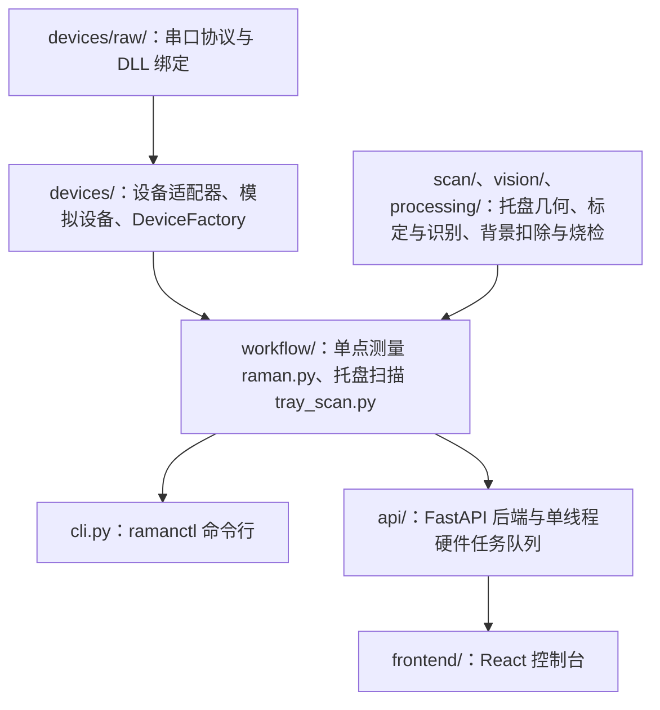

# 实验室 Raman/PL 自动化平台

本项目已归档。

本项目把老师整理的人工 PL/Raman 测量流程（[SOP](docs/lab-sop-pl-mapping-zolix-ocr.md)）改成由程序控制。程序直接调用四类设备：

- WayneLabs 电动位移台：串口，移动样品。
- Zolix 光谱仪：厂家 DLL，设置光栅、中心波长和狭缝。
- DField-VS-A4 CCD：厂家 DLL，采集光谱。
- PWM 光源控制器：Modbus RTU 串口，开关激光和白光 LED。

使用方式有两种：命令行 `ramanctl` 和浏览器里的 Web 控制台（FastAPI 后端 + React 前端）。代码在 macOS 上用模拟设备开发和测试，真实硬件只在实验室的 Windows 64 位电脑上运行。

当前进度、下一步和已知问题见 [docs/PROJECT_STATUS.md](docs/PROJECT_STATUS.md)。

## 能做什么

- **单点测量**：配置光谱仪 → 关激光采背景 → 开激光采样品 → 关激光 → 扣除背景 → 保存 CSV 与元数据。命令行和 Web 都可以运行。
- **托盘扫描**（只有命令行可以真机运行）：按托盘行列逐个移到每片晶圆中心 → 请外部程序拍照并识别样品位置 → 用像素到位移台的标定矩阵换算坐标 → 对每个样品中心及周围点各测两次，比较两次光谱判断是否烧样。中断后可以从记录文件继续。Web 端只提供不动硬件的预演。
- **设备诊断与安全**：检查 DLL 和串口、读取光源寄存器、一键关闭全部光源通道、软件急停。

## 三种运行模式

| 模式 | 用途 | 是否连接硬件 |
|------|------|------|
| `dry_run`（默认） | 只打印将要执行的动作序列 | 否 |
| `simulated` | 用模拟设备完整跑一遍并写出数据文件 | 否 |
| `real` | 控制真实设备 | 是，命令行必须加 `--real`，Web 必须 `confirm_real=true` |

设备配置文件里的 `runtime.mode: real` 不会自动生效，仍需在命令行显式加 `--real`。

## 代码结构



| 位置 | 内容 |
|------|------|
| `src/lab_auto/config.py` | 读取并校验全部 YAML 配置。参数范围、安全上限都在这里检查一次，下游代码直接使用 |
| `src/lab_auto/devices/raw/` | `waynelabs_protocol.py`、`pwm_modbus.py` 是串口帧格式；`zolix_ctypes.py`、`dfield_ctypes.py` 是 DLL 函数签名；`native.py` 负责加载 DLL |
| `src/lab_auto/devices/` | `waynelabs_stage.py`（移动、归零、位置台账）、`light.py`（激光开关与读回确认）、`zolix_spectrometer.py`、`dfield_camera.py`、`simulated.py`（模拟设备）、`factory.py`（按配置创建真实设备） |
| `src/lab_auto/workflow/` | `raman.py` 单点测量；`tray_scan.py` 托盘扫描与可恢复的 `manifest.json` |
| `src/lab_auto/api/` | `main.py` 应用入口、统一错误码、启动和关闭时的光源复位；`task_queue.py` 任务队列；`routers/` 各接口 |
| `frontend/src/` | `views/` 四个页面（单点测量、托盘预演、设备、历史），`stores/workflowStore.ts` 任务状态，`api/client.ts` 接口封装 |
| `configs/*.example.yaml` | 配置模板。本机配置（`configs/*.yaml`）不入库 |
| `tests/`、`frontend/tests/` | 后端 pytest 与前端 store 测试，全部使用模拟设备 |

## 快速开始（开发机）

需要 Python 3.11+、[uv](https://docs.astral.sh/uv/)、Node.js 20.19+。

```bash
uv venv .venv --python 3.12
uv pip install -e ".[dev,api]"
.venv/bin/python -m pytest -q                 # 后端测试
(cd frontend && npm ci && npm test && npm run lint && npm run build)   # 前端测试与构建

# 不接硬件试运行
.venv/bin/ramanctl workflow single --config configs/single_point.example.yaml --simulated --yes
.venv/bin/ramanctl scan tray --config configs/tray_scan.example.yaml --dry-run

# Web 控制台
./scripts/start_api.sh        # 后端 http://127.0.0.1:8008，接口文档 /docs
./scripts/start_frontend.sh   # 前端 http://localhost:5173
```

在实验室 Windows 电脑上部署和填写真机配置见 [docs/lab-setup.md](docs/lab-setup.md)。

## 命令行 `ramanctl`

所有命令都接受 `--dry-run`、`--simulated`、`--real` 之一，不写时按设备配置的 `runtime.mode`（默认 dry_run）。真机模式下 `stage move/home/trigger` 必须加 `--yes`。光源配置为 `manual` 时，测量流程每次开关激光都在终端等待人工确认。

```text
ramanctl devices scan|status|doctor [--config DEVICES]      检查串口、DLL 是否可加载
ramanctl stage identify|move|home|trigger --config DEVICES  位移台（move: --axis --um --speed；home: --axis --direction --speed）
ramanctl spec status|init|set --config DEVICES              光谱仪（init: --entrance --exit；set: --grating --wavelength-nm --slit-um）
ramanctl camera status|temperature|capture --config DEVICES CCD（capture: --mode fvb|image --exposure-ms --out）
ramanctl workflow single --config SINGLE [--devices-config DEVICES]
ramanctl scan tray --config TRAY [--devices-config DEVICES] [--recognition-dir DIR --session-id ID]
```

出错时打印 `error: ...` 并返回退出码 2。

## Web 控制台与 API

前端开发服务器把 `/api` 和 WebSocket 代理到 `127.0.0.1:8008`；执行 `npm run build` 后，后端也会直接托管 `frontend/dist`。

| 接口 | 作用 |
|------|------|
| `GET /api/configs?config_type=single_point\|tray` | 列出 `configs/` 下可用的配置 |
| `POST /api/workflow/single-point` | 提交单点测量，参数为 `config_path`、`mode`、`confirm_real`，可覆盖 `sample_id`、`operator`、`subtract_background` |
| `GET /api/workflow/jobs`、`GET /api/workflow/jobs/{id}` | 查询任务 |
| `POST /api/workflow/jobs/{id}/stop` | 停止任务：等待中的任务立即停止；运行中的任务先变为 `stopping`，在下一个检查点关激光后变为 `stopped` |
| `WS /api/workflow/ws/jobs/{id}` | 推送任务状态（`status` 消息带进度与结果，`error` 消息带错误原因） |
| `POST /api/workflow/tray/preview` | 托盘扫描预演，不动硬件 |
| `GET /api/devices/status`、`POST /api/devices/scan` | 设备诊断 |
| `GET /api/devices/light/status` | 只读光源寄存器，不写任何通道 |
| `POST /api/devices/light/off` | 关闭全部光源通道并读回确认；有任务运行时先取消任务 |
| `POST /api/emergency-stop` | 软件急停：取消所有任务并尽力关光源，结果如实写在 `laser_off` 字段 |
| `GET /api/history`、`GET /api/history/{id}`、`.../files/{name}` | 读取和下载已保存的单点测量 |
| `GET /api/health` | 健康检查 |

错误码：配置、设备、安全错误返回 400；硬件正在被其他操作使用返回 409；硬件调用超时返回 504；配置文件不存在返回 404。

后端只用一个线程执行所有硬件操作，同一时间只有一个操作能占用硬件。任务记录保存在 `state/api_jobs.json`，服务重启后未完成的任务标记为失败，不会自动重新执行。只能运行一个后端进程，也不能和真机命令行或厂家软件同时控制硬件。

Web 端没有开激光的接口。激光只会在已确认的测量流程中打开。

## 输出文件

单点测量写入 `output.directory`（默认 `output/measurements/<时间>-<样品ID>/`）：

- `raw.csv`：样品光谱（`pixel_index, wavelength_nm, intensity_raw, saturated`）。
- `background.csv`、`corrected.csv`：开启背景扣除时生成。
- `metadata.json`：状态（running/completed/failed/stopped）、错误原因、软件版本、配置快照、设备状态、探测器温度、人工记录的激发波长与功率。
- `run.log`：开始、完成或失败的记录。

托盘扫描在其输出目录写 `manifest.json`，记录每片晶圆、每个样品中心、每个测点的坐标、烧检结果和对应的单点输出目录。用同一配置、同一输出目录和同一 session 重新运行时跳过已完成的点；配置有任何变化都会拒绝续跑。

运行状态：`state/stage_position.json` 是位移台位置台账，`state/api_jobs.json` 是 Web 任务记录。

环境变量：`LAB_AUTO_CONFIG_DIR`（Web 可选配置目录，默认 `configs/`）、`LAB_AUTO_DEVICES_CONFIG`（Web 使用的设备配置，默认 `configs/devices.yaml`，不存在时用 example）、`LAB_AUTO_MEASUREMENTS_DIR`（历史页读取目录）、`LAB_AUTO_JOB_STATE`（任务记录文件）。

## 安全机制

改动下面任何一项之前先读 [CLAUDE.md](CLAUDE.md) 的安全红线。

- **激光**：开激光前读回确认控制器电压寄存器 Reg1 = 50（5.0 V）、其他通道全部关闭、本通道频率和占空比与配置一致，写入后再读回确认已打开。关激光会关闭全部 5 个通道并逐个读回为 0；读回失败时状态变为 `manual_wait`，提示激光可能仍在开启。软件从不写 Reg1。
- **异常路径**：测量失败或取消时一律先确认关激光；关不掉时报 `SafetyError`。创建光源（只读状态查询除外）、后端启动和正常关闭时都会把全部通道关闭一次。急停后同一个光源对象不能再开激光。
- **位移台**：协议无法读取绝对位置，软件用 `state/stage_position.json` 记录每轴状态（`unknown` / `homed`）。`unknown` 轴只允许不超过 `max_unknown_move_um` 的小步移动；已归零的轴检查软限位。移动前先写入"移动中"标记，进程中途被杀后该轴恢复为 `unknown`。归零方向必须与配置的 `home_direction` 一致。
- **参数上限**：单次曝光 ≤ 60 s，帧数 ≤ 1000，曝光 × 帧数 ≤ 60 s（激光持续照射时间上限）；烧检阈值必须大于 0。
- **托盘扫描**：X/Y 都已归零才能开始；标定必须写明图像宽高，识别图尺寸不一致时拒绝移动；超出软限位的点按配置跳过或中止。
- 软件急停依赖进程和串口正常工作，不能代替物理急停。

## 文档

| 文档 | 内容 |
|------|------|
| [docs/PROJECT_STATUS.md](docs/PROJECT_STATUS.md) | 当前进度、下一步、已知问题（每次提交后更新） |
| [docs/lab-setup.md](docs/lab-setup.md) | 实验室 Windows 部署、真机配置、现场已测得的参数、标定方法 |
| [docs/real-machine-checklist.md](docs/real-machine-checklist.md) | 当前版本真机复验清单与判据 |
| [docs/recognition-handoff.md](docs/recognition-handoff.md) | 托盘扫描与外部拍照/识别程序之间的文件握手协议 |
| [docs/lab-sop-pl-mapping-zolix-ocr.md](docs/lab-sop-pl-mapping-zolix-ocr.md) | 老师整理的人工测量流程（需求来源） |
| [CLAUDE.md](CLAUDE.md)、[AGENTS.md](AGENTS.md) | 给编程 Agent 的安全红线与工作约定 |

厂家 SDK、驱动和原始说明书（WayneLabs 串口说明、PWM 控制器协议、Zolix 与 DField SDK、老师的流程文档）不在仓库里，需要从实验室电脑或上一任维护者处单独获取，放在仓库根目录即可（已被 `.gitignore` 排除）。
