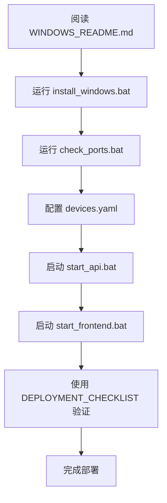

# Windows 部署文档 - 完整索引

**项目**: Raman/PL 自主实验平台  
**平台**: Windows 10/11 (64-bit)  
**版本**: 1.0  
**日期**: 2026-07-01

---

## 🎯 根据您的需求选择文档

### 我想快速开始部署
👉 **[WINDOWS_QUICK_REFERENCE.md](WINDOWS_QUICK_REFERENCE.md)**
- 快速启动命令
- 常见问题速查
- 5 分钟上手指南

### 我是第一次在 Windows 上部署
👉 **[WINDOWS_SETUP.md](WINDOWS_SETUP.md)**
- 完整安装步骤
- 系统要求检查
- 详细故障排查

### 我想了解兼容性细节
👉 **[WINDOWS_COMPATIBILITY_REPORT.md](WINDOWS_COMPATIBILITY_REPORT.md)**
- 技术兼容性分析
- 硬件驱动验证
- 代码审查结果

### 我需要部署验证清单
👉 **[WINDOWS_DEPLOYMENT_CHECKLIST.md](WINDOWS_DEPLOYMENT_CHECKLIST.md)**
- 逐步验证流程
- 功能测试清单
- 签收确认表

### 我想看分析摘要
👉 **[WINDOWS_ANALYSIS_SUMMARY.md](WINDOWS_ANALYSIS_SUMMARY.md)**
- 执行摘要
- 风险评估
- 技术决策依据

---

## 📦 快速部署（3 步）

```cmd
# 步骤 1: 自动安装
install_windows.bat

# 步骤 2: 配置设备
copy devices.yaml.windows devices.yaml
notepad devices.yaml  # 修改 COM 端口

# 步骤 3: 启动服务
start start_api.bat
start start_frontend.bat
```

访问: http://127.0.0.1:8008/docs (后端) | http://localhost:5173 (前端)

---

## 📚 完整文档列表

### 核心指南（必读）
| 文档 | 用途 | 阅读时间 |
|------|------|---------|
| [WINDOWS_README.md](WINDOWS_README.md) | 总览文档 | 5 分钟 |
| [WINDOWS_SETUP.md](WINDOWS_SETUP.md) | 安装指南 | 15 分钟 |
| [WINDOWS_QUICK_REFERENCE.md](WINDOWS_QUICK_REFERENCE.md) | 快速参考 | 3 分钟 |

### 技术文档（推荐）
| 文档 | 用途 | 阅读时间 |
|------|------|---------|
| [WINDOWS_COMPATIBILITY_REPORT.md](WINDOWS_COMPATIBILITY_REPORT.md) | 兼容性报告 | 10 分钟 |
| [WINDOWS_ANALYSIS_SUMMARY.md](WINDOWS_ANALYSIS_SUMMARY.md) | 分析摘要 | 8 分钟 |

### 操作文档（实施时）
| 文档 | 用途 | 阅读时间 |
|------|------|---------|
| [WINDOWS_DEPLOYMENT_CHECKLIST.md](WINDOWS_DEPLOYMENT_CHECKLIST.md) | 部署清单 | 20 分钟 |
| [devices.yaml.windows](devices.yaml.windows) | 配置模板 | 5 分钟 |

---

## 🔧 脚本工具

| 脚本 | 功能 | 使用场景 |
|------|------|---------|
| `install_windows.bat` | 自动安装 Python 和 Node.js 依赖 | 首次安装 |
| `start_api.bat` | 启动 FastAPI 后端服务 | 每次使用 |
| `start_frontend.bat` | 启动 React 前端界面 | 每次使用 |
| `check_ports.bat` | 检测可用 COM 端口 | 配置硬件 |

---

## 📋 兼容性总结

### ✅ 完全兼容
- Python 后端 (FastAPI)
- React 前端 (Vite)
- Zolix 光谱仪 (ctypes.WinDLL)
- NNCam 相机 (Windows DLL)
- 载物台 (pyserial)
- PWM 光源 (Modbus RTU)

### ⚠️ 需要配置
- COM 端口名称 (COM3, COM5, COM17)
- DLL 绝对路径
- 启动脚本 (.bat)

### ❌ 不兼容
- **无**

---

## 🎓 学习路径

### 初学者
1. 阅读 [WINDOWS_README.md](WINDOWS_README.md) - 了解全局
2. 运行 `install_windows.bat` - 自动安装
3. 阅读 [WINDOWS_QUICK_REFERENCE.md](WINDOWS_QUICK_REFERENCE.md) - 快速上手
4. 使用 [WINDOWS_DEPLOYMENT_CHECKLIST.md](WINDOWS_DEPLOYMENT_CHECKLIST.md) - 验证部署

### 进阶用户
1. 阅读 [WINDOWS_COMPATIBILITY_REPORT.md](WINDOWS_COMPATIBILITY_REPORT.md) - 理解技术细节
2. 阅读 [WINDOWS_ANALYSIS_SUMMARY.md](WINDOWS_ANALYSIS_SUMMARY.md) - 了解分析方法
3. 自定义配置文件
4. 优化性能设置

### 故障排查
1. 查阅 [WINDOWS_QUICK_REFERENCE.md](WINDOWS_QUICK_REFERENCE.md) § 故障排查
2. 参考 [WINDOWS_SETUP.md](WINDOWS_SETUP.md) § 常见问题
3. 检查 [WINDOWS_DEPLOYMENT_CHECKLIST.md](WINDOWS_DEPLOYMENT_CHECKLIST.md) § 验证清单

---

## 🔍 关键信息速查

### 系统要求
- Windows 10/11 (64-bit)
- Python 3.12+
- Node.js 18+
- 8GB+ RAM

### 端口配置
```yaml
stage:
  port: COM5      # 载物台

light:
  port: COM17     # PWM 光源
```

### DLL 路径
```yaml
spectrometer:
  dll_path: "C:\\Zolix\\SDK\\spec.dll"

camera:
  dll_path: "nncamsdk.20240325\\win\\x64\\nncam.dll"
```

### 服务地址
- 后端 API: http://127.0.0.1:8008
- API 文档: http://127.0.0.1:8008/docs
- 前端界面: http://localhost:5173

---

## 📊 文档结构图

```
Windows 部署文档套件
│
├── WINDOWS_INDEX.md (本文档)
│   └── 入口导航
│
├── 快速开始
│   ├── WINDOWS_README.md
│   ├── WINDOWS_QUICK_REFERENCE.md
│   └── install_windows.bat
│
├── 详细指南
│   ├── WINDOWS_SETUP.md
│   ├── WINDOWS_DEPLOYMENT_CHECKLIST.md
│   └── devices.yaml.windows
│
├── 技术分析
│   ├── WINDOWS_COMPATIBILITY_REPORT.md
│   └── WINDOWS_ANALYSIS_SUMMARY.md
│
└── 启动脚本
    ├── start_api.bat
    ├── start_frontend.bat
    └── check_ports.bat
```

---

## 🚀 推荐工作流程

### 首次部署（预计 1 小时）


### 日常使用（预计 1 分钟）
1. 双击 `start_api.bat`
2. 双击 `start_frontend.bat`
3. 访问 http://localhost:5173

### 故障排查（预计 10 分钟）
1. 查看 WINDOWS_QUICK_REFERENCE.md § 故障排查
2. 检查日志输出
3. 参考 WINDOWS_SETUP.md § 常见问题
4. 运行 `check_ports.bat` 验证硬件

---

## 📞 获取帮助

### 文档内查找
1. **安装问题** → WINDOWS_SETUP.md
2. **配置问题** → devices.yaml.windows
3. **硬件问题** → WINDOWS_COMPATIBILITY_REPORT.md
4. **操作问题** → WINDOWS_QUICK_REFERENCE.md

### 快速诊断
```cmd
# 检查 Python 环境
.venv\Scripts\activate.bat
python --version
pip list

# 检查 COM 端口
python -m serial.tools.list_ports

# 检查服务状态
curl http://127.0.0.1:8008/api/status
```

---

## ✅ 部署完成标志

部署成功后，您应该能够：
- [ ] 访问后端 API 文档 (http://127.0.0.1:8008/docs)
- [ ] 访问前端界面 (http://localhost:5173)
- [ ] 检测到所有硬件设备
- [ ] 执行基本控制命令
- [ ] 采集测试数据

全部勾选？恭喜，Windows 部署完成！🎉

---

## 📈 版本历史

| 版本 | 日期 | 变更 |
|------|------|------|
| 1.0 | 2026-07-01 | 初始版本，完整文档套件 |

---

## 🙏 反馈与改进

如果您在使用过程中遇到问题或有改进建议，请记录在部署清单的备注栏中。

---

**文档维护**: 项目团队  
**最后更新**: 2026-07-01  
**总页数**: 8 个文档 + 4 个脚本

---

**开始部署**: [WINDOWS_SETUP.md](WINDOWS_SETUP.md) →  
**快速参考**: [WINDOWS_QUICK_REFERENCE.md](WINDOWS_QUICK_REFERENCE.md) →
